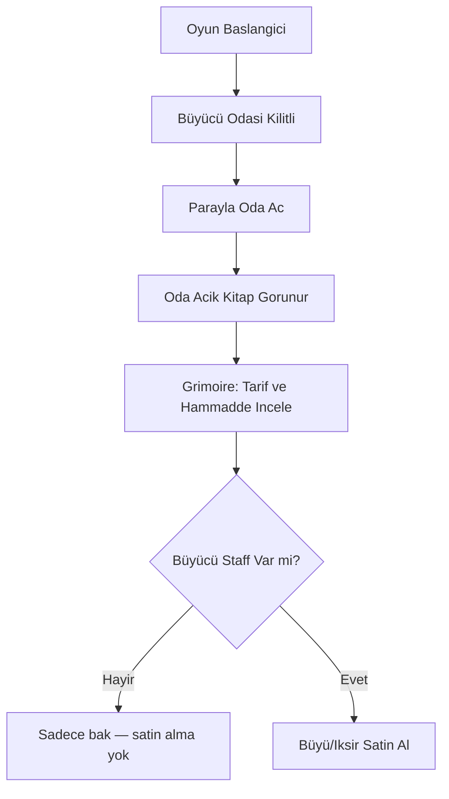
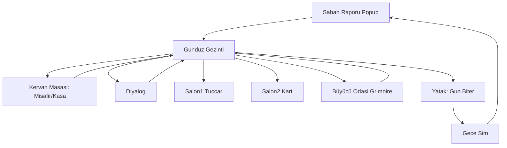

# UI Mimarisi Pivot — Grimoire vs Günlük Yönetim

## Karar Özeti

Fantasy Grimoire (satın alınan asset) **günlük yönetim hub'ı olmayacak**. Oyuncu hissi: animasyonlu kitap her gün açıldığında ağır ve tema dışı kalıyor. Asset **büyücü odasındaki büyü kitabı** olarak, daha seyrek ve tematik kullanılacak.

| UI | Konum | Kullanım sıklığı | İçerik |
|----|-------|------------------|--------|
| **Fantasy Grimoire** | Büyücünün Odası | Seyrek (iksir/büyü ihtiyacında) | Büyü seç, satın al; hammadde gereksinimlerini gör |
| **Kervan Yönetim UI** | Oyuncu odası / diğer noktalar | Her gün | Misafir kabul/red, kasa, rapor arşivi, staff, zindan |
| **Sabah Raporu** | Popup (mevcut) | Her sabah | Gece olayları, gelir/gider özeti |

---

## Fantasy Grimoire — Büyü Kitabı

**Asset:** [`Assets/FantasyGrimoireUI/`](Assets/FantasyGrimoireUI/) + mevcut [`BookInteraction.cs`](Assets/Scripts/BookInteraction.cs)

**Konum:** Büyücünün Odası (yeni sahne — henüz yapılmadı)

**Oyuncu odasındaki kitap objesi:**
- **Silinmeyecek** — animasyon ve sahne kurulumu korunur
- Büyücü odası hazır olunca **kopyalanarak** taşınır
- Taşınana kadar oyuncu odası kitabından **oyun mantığı bağlanmaz** (sadece görsel / ileride kaldırılabilir)

**Grimoire'dan yapılabilecekler:**
- Büyü / iksir listesini görüntüle (Teşhis, Koruma, ileride genişler)
- Her büyü için gerekli hammaddeleri gör
- Büyü / iksir **satın al** (craft yerine veya craft + satın al — Faz 2 detayı)

**Grimoire'dan yapılamayacaklar:**
- Misafir kabul/red
- Kasa / günlük rapor
- Staff yönetimi
- Zindan

---

## Büyücü Odası Erişim Kuralları

| Durum | Erişim |
|-------|--------|
| Oda kilitli | Girilemez |
| Oda açık, büyücü yok | Grimoire açılır; tarifler ve hammaddeler **görülebilir**, satın alma **kapalı** |
| Oda açık + büyücü staff | Grimoire'dan büyü/iksir **satın alınabilir** |

---

## Günlük Yönetim UI (Grimoire Dışı)

~~`GuestBookUI.cs`~~ → [`CaravansaryManagementUI.cs`](../Assets/Scripts/CaravansaryManagementUI.cs) + [`DeskInteraction.cs`](../Assets/Scripts/DeskInteraction.cs) (**uygulandı**).

**Hedef:** Hızlı, sade, tekrarlayan işlemlere uygun arayüz (animasyonlu sayfa çevirme yok).

**Açık karar (henüz seçilmedi):** Günlük hub'un fiziksel yeri
- **Önerilen varsayılan:** Oyuncu odasında tek **Masa / Kervan Defteri** etkileşimi → misafir + kasa + rapor arşivi tek panelde
- Alternatifler: dağıtık noktalar veya sade popup'lar

**Adım 5 (revize) — uygulama durumu:**
1. ✅ `CaravansaryManagementUI` — kitaptan ayrıldı
2. ✅ `GothicBook_10` → `GothicBookInteraction` → `DeskInteraction` (kervan yönetimi; Grimoire değil)
3. ✅ Panel sekmeleri: **Misafirler** (sol/sağ: bekleyen / konaklayan), **Kasa**, **Son Rapor**
4. ✅ `MorningReportUI` sabah popup + `MorningReportViewBuilder` yapılandırılmış rapor
5. ✅ Oyuncu odası kitabı gameplay'e bağlı değil (büyücü odasında `wizardGrimoireMode = true`)
6. ✅ `CaravansaryUITheme` ortak tema; overlay kapanması, scroll hızı, buton tıklama düzeltmeleri
7. ⏳ **UI polish (ileride):** Kervan Defteri ve Sabah Raporu — asset tabanlı görsel geliştirme (şimdilik kod ile üretilen runtime UI yeterli)

---

## Oynanış Döngüsü (Güncellenmiş)

---

## Faz Eşlemesi

### Faz 1 — tamamlandı (MVP)
- Adım 1–5: ✅ Tamamlandı + playtest onaylandı
- Adım 6: Nöbetçi staff → **Faz 2'ye ertelendi**
- Oyuncu odası kitabı: kervan defteri olarak çalışır; Grimoire büyücü odasına taşınacak
- **İleride polish:** Kervan Defteri + Sabah Raporu UI (portre, ikon, prefab/asset; runtime kod UI geçici çözüm)

### Faz 2
- Büyücü odası sahnesi + oda kilidi (parayla aç)
- Kitap objesini oyuncu odasından **kopyala** → büyücü odasına yerleştir
- `WizardGrimoireInteraction` — büyü listesi, hammadde görüntüleme, satın alma (staff gerekli)
- Teşhis / Koruma iksirleri

### Faz 4 polish
- Fantasy Grimoire asset tam entegrasyon (sayfa içi büyü kartları, görsel polish)

---

## Kod Etkisi (Uygulama Sırasında)

| Dosya | Durum |
|-------|--------|
| [`CaravansaryManagementUI.cs`](../Assets/Scripts/CaravansaryManagementUI.cs) | ✅ Günlük yönetim paneli |
| [`DeskInteraction.cs`](../Assets/Scripts/DeskInteraction.cs) | ✅ Sahneye bağlı (`GothicBook_10`) |
| [`GothicBookInteraction.cs`](../Assets/Scripts/GothicBookInteraction.cs) | ✅ Kitap → kervan defteri kurulumu |
| [`CaravansaryUITheme.cs`](../Assets/Scripts/CaravansaryUITheme.cs) | ✅ Ortak UI tema (geçici runtime UI) |
| [`MorningReportViewBuilder.cs`](../Assets/Scripts/MorningReportViewBuilder.cs) | ✅ Yapılandırılmış sabah raporu |
| [`GameOverUI.cs`](../Assets/Scripts/GameOverUI.cs) | ✅ İflas ekranı |
| [`BookInteraction.cs`](../Assets/Scripts/BookInteraction.cs) | ✅ Wizard modu eklendi |
| [`WizardGrimoireUI.cs`](../Assets/Scripts/WizardGrimoireUI.cs) | ✅ Büyü/iksir kataloğu |
| [`GameManager.cs`](../Assets/Scripts/GameManager.cs) | ✅ Alt sistemler güncellendi |

---

## Netleşen Kararlar (Bu Oturum)

- Grimoire = büyücü odası, seyrek kullanım, iksir/büyü odaklı
- Günlük yönetim = ayrı hızlı UI'lar
- Oyuncu odası kitap objesi silinmez; büyücü odasına kopyalanır
- Büyücü odası: parayla açılır; büyücü staff olmadan sadece inceleme; staff ile satın alma
- Vampir sayısı oyuncuya gösterilmez (zaten uygulandı)

## Açık Karar

- Günlük yönetim hub'u tam olarak nerede ve nasıl görünecek? (Masa tek panel vs dağıtık vs popup-only)