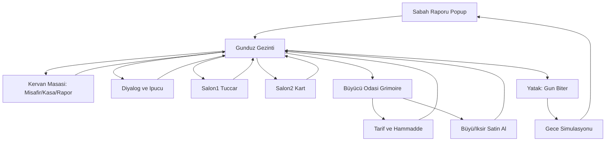
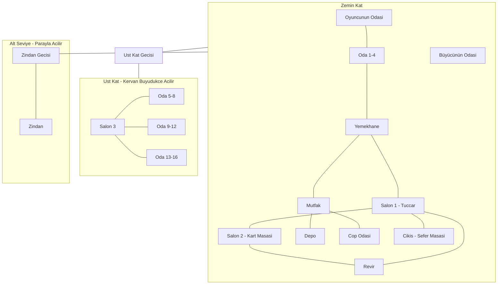
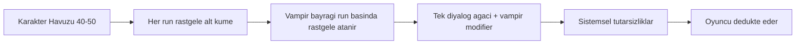
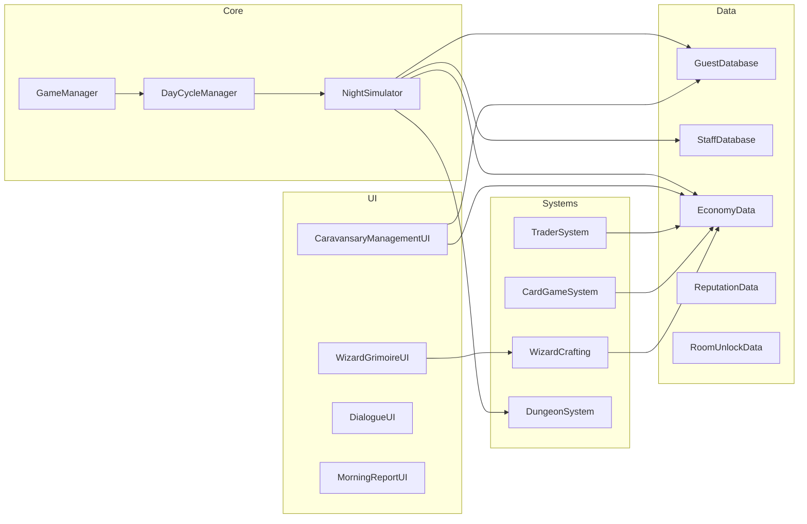

# Vampyrum — Oyun Tasarım Planı (GDD)

## Oyun Özeti

**Vampyrum**, oyuncunun **kervansaray sahibi** olduğu, vampirlerin insan kılığında misafir olarak kaldığı bir **yönetim + sosyal dedüksiyon** oyunudur.

- **Tema:** 1300-1500, gothic kervansaray / han
- **Evren:** Vampirlerin var olduğu bir dünya — tehdit doğal, gizemli bir köken hikâyesi gerektirmez
- **Oyuncu rolü:** Kervansarayın sahibi ve işletmecisi
- **Kamera:** 2D top-down
- **Ton:** Gerilimli, hikâye odaklı, kararların sonuçları ağır basar
- **Ana gerilim:** Gelir için misafir almak zorundasın, ama her misafir potansiyel bir vampir

### Kazanma / Kaybetme

| Koşul | Açıklama |
|-------|----------|
| **Kaybet — İflas** | Kasa eksiye düşer, işletme kapanır |
| **Kaybet — İtibar çöküşü** | Ard arda cinayetler veya hatalı kararlar itibarı sıfırlar → Game Over |
| **Kaybet — Vampir istilası** | İçerideki vampir sayısı belirlenen eşiğe ulaşır |
| **Kazanma (Steam sürümü)** | Ana hikâye tamamlanır + kervan ayakta kalır (detaylar ileride) |

---

## Oynanış Döngüsü



### Gün Yapısı

- **Sabah:** Gece raporu popup olarak görünür; arşiv Kervan Defteri'nde
- **Gündüz:** Gezinti, diyalog, tüccar/kart oyunu, zindan, iksir — **süre sınırı yok**
- **Gece:** Otomatik simülasyon (vampir saldırısı, nöbetçi raporu, kaynak tüketimi, NPC ayrılışları)
- **Gün sonu:** Oyuncu yatağa girince gün biter

---

## Harita Planı (Oyuncu Çizimi)



### Oda / Alan İşlevleri Tablosu

| Oda / Alan | İşlev | Açılış Durumu | Mevcut Unity Sahnesi |
|------------|-------|---------------|----------------------|
| **Oyuncunun Odası** | Günü bitir (Uyu), Kervan Defteri (masa), dekoratif kitap | Başlangıçta açık | `Player's_Room.unity` |
| **Oda 1–4** | Zemin kat misafir / işçi odaları | Başlangıçta açık | Koridor bağlantılı (yeni sahneler) |
| **Mutfak & Yemekhane** | Gıda işleme, personel yemek merkezi | Başlangıçta açık | `DiningRoom.unity` (kısmen) |
| **Depo** | Gıda, taş, tahta, iksir malzemesi stok | Parayla açılır / tamir | Yeni sahne |
| **Çöp Odası** | Atık alanı; temizlenmezse fare/hastalık | Başlangıçta açık | Yeni sahne |
| **Salon 1** | Giriş holü; **Seyyar Tüccar** burada | Başlangıçta açık | `Salon1.unity` (boş) |
| **Salon 2** | Dinlenme; **Bahisli Kart Oyunu** | Başlangıçta açık | `Salon2.unity` (boş) |
| **Revir** | Yaralı/hasta iyileşme; kapalıysa yaralılar ölür | Parayla açılır / tamir | Yeni sahne |
| **Büyücünün Odası** | İksir laboratuvarı | Başlangıçta açık | Yeni sahne |
| **Çıkış (Sefer Masası)** | İnsanları hammadde toplamaya gönderme panosu | Başlangıçta açık | Yeni sahne / trigger |
| **Zindan & Geçişi** | Şüpheli tecrit, sorgu, test, ceza | Parayla açılır / tamir | Yeni sahne (Catacombs tileset) |
| **Üst Kat Geçişi** | Zemin → Salon 3 merdiven portalı | Parayla açılır | Yeni geçiş trigger |
| **Salon 3 & Oda 5–16** | Geniş yatakhane kanadı (12 ek oda) | Kervan büyüdükçe açılır | Yeni sahne grubu |

**Toplam kapasite:** Zemin kat 4 oda + üst kat 12 oda = **16 misafir odası** (+ staff yer kaplar)

---

## Ana Sistemler

### 1. Kervansaray İşletmesi & Ekonomi

**Gelir (onaylanan kaynaklar):**
- **Konaklama ücreti (peşin):** Misafir kabulde `ucret_gunluk × kalis_gunu` toplu alınır; erken ayrılım/ölümde kalan günler iade edilir ([`docs/npc/`](npc/README.md))
- **Barındırma maliyeti:** Misafir başına `maliyet_gunluk` — oyuncuya gider, her gece düşer (yemek, iaşe vb.)
- **Konfiske eşya satışı:** İdam/sürgün sonrası eşya satışı (Faz 2)
- **Keşifçi ticareti:** Getirilen malları misafir/tüccara sat (Faz 2)
- **Tüccar:** Takas **+ düz satın alma** (altın karşılığı mal) (Faz 2)
- **Depo kira:** Eşya depolama günlük ücreti (Faz 2 — Depo açılınca)
- **Vampir ödülü:** Doğrulanmış vampir başına makul para; **kilometre taşları** 5 / 10 / 20 vampirde ekstra ödül (Faz 2–3)
- **Özel etkinlik:** Asilzade düğün konvoyu vb. — 3 gün kalır, ~100 altın, yüksek risk (Faz 3)
- **Kart oyunu kazançları** (Faz 2+ — acelesi yok)

**Gider:**
- **Sabit günlük giderler:** Kervan bakımı + kervan vergisi (misafir olmasa da ödenir)
- Staff maaşları
- Günlük erzak / yemek tüketimi (misafir + staff)
- Zindandakilerin iaşesi (hapiste de yemek yer)
- Kilitli oda açma / tamir maliyetleri (Depo, Revir, Zindan, Üst Kat) — **kervan yükseltme yok**, sadece oda kilidi açılır

**Anti-exploit — “Herkesi reddet” stratejisi:**
- Misafir kabul edilmezse kira gelmez ama **sabit giderler devam eder**
- Bu strateji birkaç gün içinde **garantili iflas**a götürür → oynanamaz hale gelir

### Ek Gelir Kaynakları

| Kaynak | Durum |
|--------|-------|
| Konaklama peşin + günlük maliyet | Onaylandı — Faz 1.5 ([npc/](npc/README.md)) |
| Konfiske satış | Onaylandı — Faz 2 |
| Keşifçi ticareti | Onaylandı — Faz 2 |
| Tüccar takas + düz satış | Onaylandı — Faz 2 |
| Depo kira | Onaylandı — Faz 2 |
| Vampir ödülü + kilometre taşları (5/10/20) | Onaylandı — Faz 2–3 |
| Asilzade düğün konvoyu | Onaylandı — Faz 3 |
| Koruma iksiri satışı | Opsiyonel — Faz 3+ |

**Tasarım notu:** Ana gelir hâlâ **kira**; ek kaynaklar nefes aldırır ama kira olmadan ayakta kalınamaz.

**Kaynaklar (Depo):**
- Buğday, erzak, değerli taşlar, tahta, ot/hammadde, iksirler

**İflas / Game Over:**
- Kasa eksiye düşerse
- VEYA ardı ardına cinayetler + hatalı kararlar itibarı sıfırlarsa

### 2. Misafir Sistemi

Her gün dışarıdan yolcular gelir. Kervan Defteri'nde profil:

- Portre, isim, yaş
- Nereden / nereye
- Gece başına kira (altın)
- Kısa hikâye
- Kabul / red kararı Kervan Defteri'nden

**Misafir türleri:**
- **Standart yolcu:** Normal gece kirası (ör. 5 altın)
- **Zengin / şüpheli yolcu:** Çok yüksek kira (ör. 25 altın) ama profilinde bariz kırmızı bayraklar — iflas riskinde **bilinçli risk/al** kararı
- **Bağlantılı çiftler:** Birlikte gelen karakterler; birini reddetmek diğerini etkiler

**Günlük gelen sayısı — hava / olay etkisi:**
- **Fırtına / kötü hava:** Daha fazla yolcu gelir (sığınma ararlar)
- **Güzel gün:** Daha az yolcu gelir
- **Beklenmedik eventler:** İleride eklenecek (henüz tanımlanmadı)

**Risk:** Vampirler gece birini öldürür.

**Vampir oranı (balans):** Henüz sabit değil — prototip sırasında **ayarlanabilir parametre** olarak kodlanacak, playtest ile netleştirilecek.

### 3. Staff Sistemi (max 4-5)

Staff misafir kapasitesinden yer kaplar. **Staff asla vampir olamaz** — sabit işlev, banko performans.

| Rol | İşlev |
|-----|-------|
| **Nöbetçi** | Gece devriye → sabah detaylı rapor + ipuçları |
| **Keşifçi** | Sefer Masası'ndan dışarı gönderilir → malları getirir, satış geliri (Faz 2) |
| **Büyücü** | Büyücünün Odası'nda iksir üretir |
| *(Diğer roller)* | Aşçı, hizmetçi vb. — henüz tanımlanmadı |

**Staff maaşları:** Oyun gidişatına göre ileride belirlenecek.

### 4. Büyücü & İksir Üretimi

**Konum:** Büyücünün Odası — **parayla açılır**; Fantasy Grimoire asset bu odadaki **büyü kitabı** olarak kullanılır

**Erişim kuralları:**
- Oda kilitliyken girilemez
- Oda açık, büyücü staff yok → Grimoire'dan tarif ve hammaddeler **görülebilir**, satın alma **kapalı**
- Oda açık + büyücü staff → büyü/iksir **satın alınabilir**

**Oyuncu odası kitabı:** Görsel olarak kalır (animasyon korunur); günlük yönetime bağlanmaz. Büyücü odası hazır olunca oraya kopyalanır.

Zor hammaddeler karşılığında iksir üretimi:

| İksir | Etki | Durum |
|-------|------|-------|
| **Vampir Teşhis İksiri** | Şüphelinin kanını test eder → **yüzdelik ipucu** verir (ör. "%80 vampir"), kesin sonuç değil | Onaylandı |
| **Koruma İksiri** | Seçilen karakter bir geceliğine vampir saldırısına karşı dokunulmaz | Onaylandı |
| *(Genişletilebilir)* | İleride yeni büyüler eklenebilir | — |

**Kaldırılan:** Diriltme / Hayat İksiri — ölüm kalıcı, gerilim korunur

**Teşhis iksiri kuralları:**
- **Çok pahalı** — nadir bir hammadde ile craftlanır
- Günlük üretim sınırı **yok** (kaynak yettiği kadar)
- %100 kesinlik vermez → dedüksiyon hâlâ önemli kalır

### 5. Tüccar & Takas (Salon 1)

- Her gün kervana uğrayan **seyyar tüccar** Salon 1'de bekler
- **Takas:** "3 Çuval Buğday ver → 1 Kutsal Taş al"
- **Düz satış:** Altın karşılığı mal satın alma (envanterden)

**Özel NPC kuralları (Tüccar + Gizemli Yabancı):**
- Staff değil, misafir değil, vampir değil
- **Gece kervanda kalmaz** → cinayet simülasyonuna dahil olmaz, vampir olamaz
- Sadece oyunu oynanabilir ve keyifli kılmak için var (ekonomi / ipucu kaynağı)
- Her gece ayrılır, sabah tekrar gelir

### 6. Bahisli Kart Oyunu (Salon 2) — Faz 2+, acelesi yok

- **Gizemli yabancı** ile kart oyunu (kurallar ileride belirlenecek)
- Oyuncu değerli envanter eşyası koyar; yabancı eşdeğer nesne sürer
- **Kazanan** masadaki iki eşyayı da alır
- Bazen yabancı eşya yerine **vampir kimliğine dair özel ipucu** koyabilir
- Gece kervanda kalmaz (Tüccar ile aynı özel NPC kuralları — yukarıya bak)

### 7. Zindan & Yargılama

**Akış:** Şüpheli gündüz zindana atılır (kitaptan veya etkileşimden).

**Zindanın gece etkisi (dedüksiyon aracı):**
- Zindandaki kişi gece cinayet **işleyemez**
- O gece cinayet **durursa** → şüphe büyük olasılıkla doğru
- Cinayet **sürerse** → içerideki masum VEYA kervanda birden fazla vampir var

**Maliyet:** Zindandaki kişi günlük erzak tüketmeye devam eder.

**Zindan Aksiyonları:**

| # | Aksiyon | Sonuç |
|---|---------|-------|
| 1 | **Sorgula** | Dedikodu ve ifade al |
| 2 | **Büyücü İksiriyle Test Et** | Yüzdelik sonuç (ör. %80 vampir) — kesin değil |
| 3 | **İdam Et** | Vampirse tehdit biter; masumsa moral çöker, isyan riski |
| 4 | **Kov / Sürgün Et** | Kervansaraydan dışarı at |
| 5 | **Serbest Bırak** | Masumsa odaya geri gönder (sadakat geçici düşük) |

**Açılış:** Parayla açılır / tamir edilir. Tileset: [`RF Catacombs`](Assets/Assets/RF_Catacombs_v1.0/)

### 8. İtibar Sistemi

| İtibar | Etki |
|--------|------|
| Yüksek | Zengin misafirler, daha çok yolcu, açık diyalog |
| Düşük | Fakir misafirler, az yolcu, kaçamak cevaplar, düşük gelir |

**Tetikleyiciler:** Masum idam, haksız ceza, ard arda cinayetler, skandal.

**Misafir sadakati (onaylandı):**
- İyi muamele + uzun konaklama → daha açık diyalog, ipucu verme eğilimi
- Kötü muamele / haksız ceza → kaçamak cevaplar, düşük sadakat
- Kovulan kişinin tanıdığı sonraki misafir olumsuz etkilenebilir

### 9. UI Mimarisi — Kervan Defteri vs Grimoire

**Günlük yönetim (her gün):** [`CaravansaryManagementUI.cs`](Assets/Scripts/CaravansaryManagementUI.cs) — oyuncu odası **Masa/Defter** etkileşimi ([`DeskInteraction.cs`](Assets/Scripts/DeskInteraction.cs))

| Sekme | İçerik |
|-------|--------|
| Misafirler | Kabul/red, konaklayanlar |
| Kasa | Altın, son gece geliri |
| Rapor | Son sabah raporu arşivi |

**Sabah raporu:** [`MorningReportUI.cs`](Assets/Scripts/MorningReportUI.cs) popup (yataktan sonra)

**Fantasy Grimoire (seyrek kullanım):** Büyücünün Odası — [`BookInteraction.cs`](Assets/Scripts/BookInteraction.cs) wizard modu + [`WizardGrimoireUI.cs`](Assets/Scripts/WizardGrimoireUI.cs)
- Büyü/iksir listesi, hammadde gereksinimleri, satın alma (staff gerekli)
- Misafir, kasa, zindan, staff **Grimoire'da değil**

**Faz 2+ Kervan Defteri sekmeleri:** Staff, zindan, envanter, görevler, not defteri

**Günlük özet ekranı (onaylandı):** Sabah popup + Kervan Defteri Rapor sekmesi

### 10. Özel Mekân Mekanikleri

| Mekân | Mekanik |
|-------|---------|
| **Revir** | Yaralı/hasta iyileşir; kapalıysa yaralılar **ölür** |
| **Çöp Odası** | Temizlenmezse fare/hastalık eventi |
| **Sefer Masası (Çıkış)** | NPC'leri hammadde toplamaya gönder |
| **Depo** | Tüm kaynakların fiziksel stok noktası (UI envanterle bağlı) |

### 11. Diyalog ve Hikâye

- **Oyuncu:** Kervansarayın sahibi — evrenin doğal parçası olarak vampir tehdidini yönetir
- **Evren:** Vampirler var ama insanlar hayatına devam eder; ticaret, yolculuk, iş normal şekilde sürer — bu yüzden yolcular gelmeye devam eder
- Her karakterin kendi hikâyesi; **bağlantılı çiftler** ve ihtimale bağlı olaylar
- Diyaloglardan ipucu toplama
- Ana + yan görevler kitapta

*(Ana hikâye detayları — karakter hikâyeleri ileride doldurulacak)*

### 12. Karakter Havuzu & Vampir Atama Tasarımı

**Problem:** 40–50 karakter; her save'de farklı vampir atanması meta-game (ezber) ve çift diyalog yükü yaratır.

**Önerilen model — "Sabit kimlik, rastgele vampir, sistemsel ipuçları":**



| Katman | Açıklama |
|--------|----------|
| **Sabit karakter profili** | Ali her zaman Ali — geçmiş, meslek, kişilik, portre sabit |
| **Rastgele vampir atama** | Her **run** (yeni oyun) başında havuzdan rastgele X vampir seçilir; save slot ≠ sabit vampir |
| **Tek diyalog ağacı** | Her karakter için **bir** ana diyalog seti (insan halinde nasıl konuşur) |
| **Vampir modifier katmanı** | Ayrı ağaç yazmak yerine: kaçamak cevaplar, tutarsızlık, gerginlik — **5–10 evasive template** tüm vampirler paylaşır |
| **Sistemsel tells** | Nöbetçi raporu, zindan testi, çelişen ifadeler (gün 1 vs gün 3 farklı "nereden geldin"), davranış anomalileri |
| **Hikâye karakterleri** | 8–12 "ana" karakter tam yazılır; geri kalan 30+ **archetype** (Tüccar Yolcusu, Hacı, Asker) — daha az özel diyalog |

**I'm Not a Human farkı:** Orada her karakterin *türü* değişir (insan/alien). Sende tür sabit, sadece *gizli vampir bayrağı* değişir — yazım yükü çok daha düşük.

**Meta-game önleme:**
- Run başına random seed
- Her run'da havuzun **alt kümesi** gelir (40 karakterden 15–20'si) — tüm cast her oyunda yok
- Vampir ataması run başında, dosyada "Ali=always vampire" yok

**Yazım bütçesi (gerçekçi):**
- ~10 ana karakter: zengin diyalog + hikâye bağı
- ~15 yan karakter: orta diyalog + 2–3 ipucu satırı
- ~25 arka plan: kısa profil + generic + shared vampire tells
- **Çift ağaç (tam insan + tam vampir) 50 karakter için yapılmamalı**

**Havuz boyutu vs oyun süresi — matematik:**

| Senaryo | Hesap |
|---------|-------|
| 4 yeni aday/gün × 12 gün (prototip) | ~48 başvuru |
| 4 yeni aday/gün × 30 gün (Steam hedefi) | ~120 başvuru |
| 40–50 elle yazılmış karakter | Tek run'da havuz **tükenir** |

**Sonuç:** 40–50 karakter **tüm run'lar için toplam havuz** olarak yeterli; **tek run'da hepsinin gelmesi gerekmez** ve gelmemeli.

**Çözüm — hibrit spawn modeli (önerilen):**

| Katman | Run başına | Rol |
|--------|------------|-----|
| **Planlı hikâye karakterleri** | 8–12 | Belirli günlerde gelir (Gün 3'te Ali, Gün 7'de düğün konvoyu vb.) |
| **Havuzdan rastgele** | 10–15 | Run seed'ine göre havuzdan çekilir; her oyunda farklı yüzler |
| **Archetype doldurucu** | Sınırsız | "Yorgun tüccar", "Hacı" — kısa profil, paylaşılan diyalog, isim/portre varyasyonu |

**Günlük 4 aday ≠ 4 tam karakter:**
- 1–2 **derin** karakter (diyalog, hikâye, ipucu)
- 1–2 **doldurucu** (kısa profil, ekonomik karar — kabul/red odaklı)

**Tekrarlayan misafirler (onaylanabilir):**
- 2–3 geceliğini doldurup giden karakter **10 gün sonra tekrar** gelebilir
- Aynı Ali, farklı run'da farklı vampir bayrağı — tanıdık yüz, yeni şüphe

**Oyun süresi hedefi:**
- **Prototip:** 10–12 gün, 8–10 elle yazılmış karakter yeter
- **Steam sürümü:** 25–35 gün — recurrence + archetype + planlı cast ile 40–50 havuz yeter, 100+ elle yazım gerekmez

**40–50 daha fazla yapmalı mıyız?** Hayır — sayıyı artırmak yerine **seyreltme + archetype + tekrar gelen misafir** daha sağlıklı. Kalite > kvantite.

### 13. Olay & Hava Sistemi

| Olay | Etki |
|------|------|
| **Fırtına / kötü hava** | O gün daha fazla yolcu gelir |
| **Güzel gün** | Daha az yolcu gelir |
| **Beklenmedik eventler** | Henüz tanımlanmadı — ileride eklenecek |

### 14. İlerleme & Zorluk

- **Kervan yükseltme yok** — sadece kilitli oda açma
- **Zorluk eğrisi (onaylandı):** İlk ~5 gün düşük vampir oranı / öğretici; playtest ile kademeli artış

---

## Teknik Durum

### Mevcut altyapı

- [`PlayerController.cs`](Assets/Scripts/PlayerController.cs) — WASD, 4 yön animasyon
- [`SceneTransition.cs`](Assets/Scripts/SceneTransition.cs) — Oda geçişleri
- [`CameraFollow.cs`](Assets/Scripts/CameraFollow.cs) — Kamera takibi
- [`BookInteraction.cs`](Assets/Scripts/BookInteraction.cs) — Kitap aç/kapa, sayfa çevirme
- 5 sahne build'de: Player's Room, Corridor, DiningRoom, Salon1, Salon2
- Tilemap paletleri + Castle/Catacombs tileset'leri

### Eksik sistemler

- GameManager / DayCycle / NightSimulator
- Ekonomi, envanter, kira, iaşe giderleri
- Misafir spawn + profil sistemi
- Staff + sefer görevleri
- Zindan yargılama
- Büyücü + iksir crafting
- Tüccar takas + kart oyunu
- Özel NPC'ler (tüccar, yabancı) gece/sabah döngüsü
- Oda açma/kilit sistemi (Depo, Revir, Zindan, Üst Kat)
- İtibar, moral, hastalık eventleri
- Diyalog sistemi
- Save/load, ses

### Notlar

- **Player's Room spawn:** Tek giriş; bilinçli tasarım — düzeltme gerekmez
- **PixelLab:** Misafir portreleri / NPC sprite'ları (Faz 1'de 2–3 test misafir)

---

## Geliştirme Fazları

### Faz 1 — Oynanabilir Prototip (MVP)

**Hedef:** Mevcut odalarda gezinerek **1 tam gün döngüsü** hissettirmek. Zemin katın tamamı veya Salon 1/2 şimdilik yok.

**Mevcut sahneler (korunacak, layout değişmeyecek):**
Player's Room, Oda 1–4, Yemekhane, Mutfak, Çöp Odası, Depo, Koridor

**Spawn notu:** Player's Room tek girişli; karakter odaya girince doğru konumda — **bug değil, bilinçli tasarım.**

**Karakter sanatı:** PixelLab (1 aylık üyelik) — misafir portreleri ve ek NPC sprite'ları için kullanılacak. MVP'de 2–3 test misafiri portresi yeter.

**Önerilen uygulama sırası (kolay → zor):**

| Adım | Ne | Neden önce |
|------|-----|------------|
| **1** | `GameManager` singleton (gün, altın, oyun durumu) | Her şey buna bağlanır |
| **2** | Yatak etkileşimi → gün bitir | Mevcut Player's Room'da hemen test edilir |
| **3** | Gece sim + sabah rapor (basit UI/text) | Döngünün kalbi |
| **4** | Ekonomi: sabit gider + 2–3 hardcoded misafir + kabul/red | Oyun hissi burada başlar |
| **5** | Kervan Defteri (Misafir, Kasa, Rapor) — masa UI | Grimoire günlük yönetimden ayrıldı |
| **6** | Nöbetçi + rapor kalitesi | Döngü çalışınca eklenir |

**Faz 1 checklist:**
- [x] Adım 1: GameManager + gün sayacı + altın
- [x] Adım 2: Yatağa girince gün bitişi (`BedInteraction`, trigger otomatik genişletme)
- [x] Adım 3: Gece simülasyonu + sabah rapor ekranı (`MorningReportUI`)
- [x] Adım 4: Misafir kabul/red + kira + yemek ücreti + sabit gider + iflas
- [x] Adım 5: Kervan Defteri UI — Misafir + Kasa + Rapor (`GothicBook_10` → kervan yönetimi)
- [ ] Adım 6: Nöbetçi staff → **Faz 2'ye ertelendi** (henüz NPC/karakter yok; soyut rapor metni anlamsız)

**Faz 1 playtest (onaylandı):** Yatak E tüm alan, misafir kabul/red, iflas ekranı, overlay kapanması, scroll hızı.

**Faz 1 polish (ileride — MVP sonrası):**
- Kervan Defteri UI görsel geliştirme (asset, portreler, animasyon)
- Sabah Raporu UI görsel geliştirme (daha zengin layout, ikonlar)
- Debug HUD yerine kalıcı oyun içi HUD (gün / altın)
- Misafir portreleri (PixelLab, 2–3 test)

**Faz 1'de YOK (ertelendi):** Zindan, tüccar, kart, üst kat, diyalog ağacı, yeni oda layout, spawn fix, Salon 1/2, nöbetçi staff

### Faz 2 — Core Loop

- [ ] Zindan + 5 yargılama aksiyonu + gece dedüksiyon mantığı
- [ ] Büyücü odası (parayla aç) + Grimoire büyü kitabı + teşhis/koruma iksirleri
- [ ] Büyücü staff işe alma — Grimoire'dan satın alma kapısı
- [ ] Salon 1 tüccar (dinamik takas)
- [ ] Salon 2 kart oyunu + ipucu ödülü
- [ ] Tüccar & Yabancı gece ayrılış / sabah dönüş
- [ ] Sefer Masası + keşifçi görevleri
- [ ] Depo açma/tamir + envanter UI
- [ ] İtibar sistemi
- [ ] Üst kat (Salon 3 + Oda 5-16) açılış sistemi
- [ ] Diyalog sistemi entegrasyonu

### Faz 3 — İçerik & Mekân Genişlemesi

- [ ] Revir (yaralı iyileşme)
- [ ] Çöp odası / hastalık eventi
- [ ] Ana hikâye + 10+ karakter profili
- [ ] Yan görevler, bağlantılı hikâyeler
- [ ] Hava/olay sistemi (fırtına = çok misafir, güzel gün = az misafir)
- [ ] Bağlantılı çift misafirler + zengin/şüpheli yolcu profili
- [ ] Kitap not defteri sekmesi
- [ ] Vampir oranı playtest ile balans

### Faz 4 — Steam

- [ ] Save/load
- [ ] Ses + müzik
- [ ] UI/UX polish (Kitap asset entegrasyonu)
- [ ] Ekonomi / itibar / vampir balansı
- [ ] Steam sayfası, build, playtest

---

## Mimari Öneri



**Önerilen klasör yapısı:**
```
Assets/Scripts/
  Core/         — GameManager, DayCycle, NightSim
  Guests/       — GuestData, GuestSpawner
  Staff/        — StaffManager, roles, expedition
  Economy/      — Inventory, Rent, Expenses, Trade
  Reputation/   — ReputationManager
  Dungeon/      — Prisoner, JudgmentActions
  Wizard/       — PotionCrafting, recipes
  Minigames/    — CardGame, TraderOffers
  Rooms/        — RoomUnlock, special room effects
  UI/           — CaravansaryManagement, WizardGrimoire, MorningReport
  Dialogue/     — DialogueSystem
```

---

## Açık Tasarım Kararları

1. **Vampir oranı:** Playtest ile ayarlanacak
2. **Staff maaşları:** Oyun gidişatına göre ileride konuşulacak
3. **Kart oyunu kuralları:** Faz 2+ — acelesi yok
4. **Üst kat açılış eşiği:** Kaç altın / kaç gün?
5. **Beklenmedik eventler:** Sonraki fazlarda konuşulacak
6. **Karakter/vampir yazım modeli:** Ana + yan + archetype katmanları (Bölüm 12)

### Netleşen Kararlar

- **Oyuncu:** Kervansaray sahibi
- **Evren:** Vampirler bilinir; öldürülen vampir başına ödül + 5/10/20 kilometre taşı
- **Büyücü:** Staff — vampir olamaz
- **Staff genel:** Asla vampir; sabit işlev
- **İbadethane / Diriltme:** Kaldırıldı
- **Gündüz süre sınırı:** Yok — oyuncu hazır olunca yatar
- **Sabit giderler:** Kervan bakımı + vergi → “herkesi reddet” = iflas
- **Teşhis iksiri:** Pahalı, nadir malzeme, yüzdelik ipucu (~%80), kesin değil
- **Tüccar & Yabancı:** Özel NPC — gece kalmaz, vampir olamaz, staff/misafir değil
- **Kervan yükseltme:** Yok — sadece kilitli oda açma
- **Not defteri:** Kervan Defteri'nde (Faz 2+)
- **UI pivot:** Grimoire = büyücü odası büyü kitabı; günlük yönetim = Kervan Defteri (masa)
- **Büyücü odası:** Parayla açılır; staff olmadan sadece tarif inceleme
- **Bağlantılı çiftler:** Var
- **Zengin/şüpheli misafir:** Yüksek kira + bariz risk — bilinçli near-miss kararı
- **Hava etkisi:** Fırtına = çok misafir, güzel gün = az misafir
- **Ek gelir:** Yemek, konfiske, keşifçi, tüccar satış, depo kira, vampir ödülü, düğün event
- **Misafir sadakati:** Onaylandı
- **Günlük özet ekranı:** Onaylandı
- **Zorluk eğrisi:** Onaylandı — erken günler kolay
- **Vampir atama:** Run başına rastgele; tek diyalog + modifier/tells (Bölüm 12)

---

## Sonraki Adım

**Faz 1 MVP kod döngüsü tamamlandı (Eylül 2026).** Sırada:
1. **Faz 2** — zindan, dedüksiyon, büyücü odası + Grimoire gameplay
2. İsteğe bağlı polish — Kervan Defteri ve Sabah Raporu UI (görsel/asset)
3. PixelLab misafir portreleri